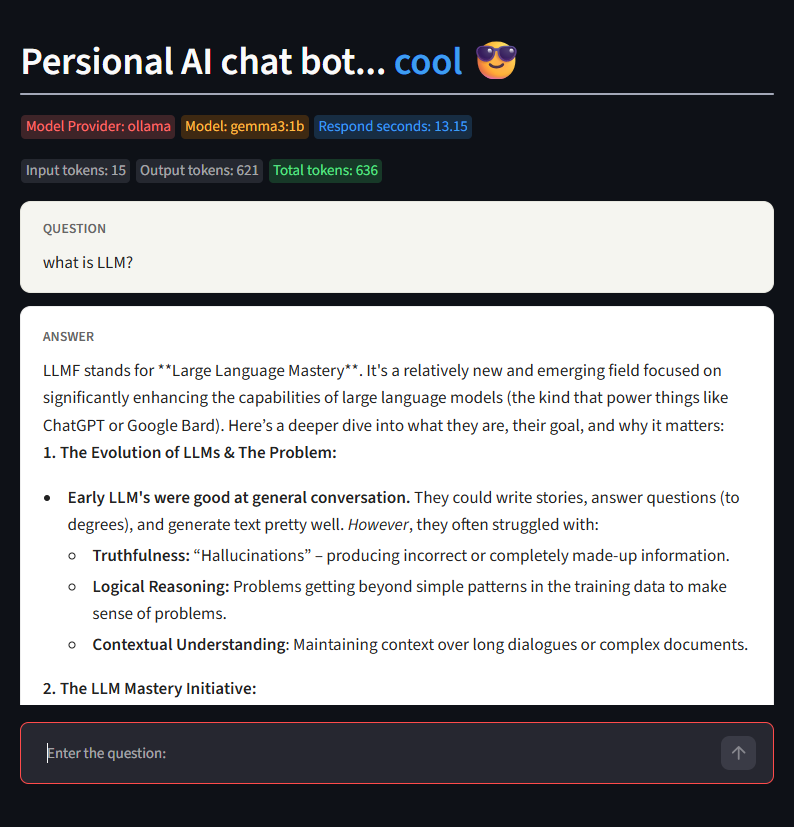

# Local AI Chatbot with LangChain and Ollama

A sample chatbot that uses LangChain to connect to a locally running Ollama model. It includes a command-line chat and a Streamlit web interface, both configured to use `gemma3:1b`.

## Features

- Ask questions using the Gemma 3 1B model through Ollama.
- Run the chatbot in a terminal or through a browser-based Streamlit interface.
- View response timing, model details, and token usage in the Streamlit interface.

## Project Files

- `gemma_demo.py` — command-line chatbot.
- `gemma_demo_using_streamlit.py` — Streamlit chatbot interface.
- `mistral_demo_using_streamlit.py` — Streamlit chatbot interface.
- `prompt_template.py` — reserved for prompt-template examples.
- `requirements.txt` — Python dependencies for the project. 
    (`$ uv pip freeze > requirements.txt` # used to generate requirements.txt)

## Prerequisites

- Python and [uv](https://docs.astral.sh/uv/).
- [Ollama](https://ollama.com/) installed and running locally.
- The Gemma model downloaded in Ollama.

On Windows, install uv with:

```powershell
winget install --id=astral-sh.uv -e
```

Download the model before starting either app:

```powershell
ollama pull gemma3:1b
```

On Linux platform:

```bash
$ sudo apt install python3.14-venv -y
$ python3 -m venv .venv
$ . .venv/bin/activate

(.venv) <...AI-LangChain>$ python --version
Python 3.14.4
(.venv) <...AI-LangChain>$ which python
/path/to/the/folder/where/.venv/bin/python

```

## Setup

From the project directory, create and activate a virtual environment, then install the dependencies:

```powershell
uv venv
.\.venv\Scripts\Activate.ps1
uv pip install -r requirements.txt
```

If you prefer to install only the packages used directly by the app:

```powershell
uv pip install langchain-ollama streamlit
```

## Run the Chatbot

For the command-line version:

```powershell
python gemma_demo.py
```

For the Streamlit version:

```powershell
streamlit run gemma_demo_using_streamlit.py
```

Streamlit opens the app at <http://localhost:8501> by default.

## Configuration and Debugging

Both scripts currently use the Ollama model `gemma3:1b`. Change the `model` argument in the relevant script to use another model that is available locally in Ollama.

The Streamlit app imports LangChain's debug helper from `langchain_core.globals`. To enable LangChain debug logging, change `set_debug(False)` to `set_debug(True)` in `gemma_demo_using_streamlit.py`.

## Screen of personal chat-bot



___
___

## Simple Sequential Chain

### Example of speech prompt template:

You are an experienced speech writter.
You need to craft an impactful title for a speech on the following topic: {topic}
Answer exactly with one title.

---

You need to write a powerful speech of 350 words for the following title: {title}

---

### Emotions:
* Inspiring
* Passionate
* Empathetic
* Motivational
* Heartfelt
* Uplifting
* Empowering
* Sincere
* Hopeful
* Enthusiastic

## Embeddings
### Embeddings are mathematical representation of words, phrases and sentences. That captures the menaing and relatedeness.
Embeddings are numerical (vector) representations of words, phrases, sentences, images, or other data in a multidimensional space.

They capture semantic meaning and relationships between data points.

The main idea is:
- Similar meanings → vectors tend to be closer. (Cosine Similarity)
- Different meanings → vectors tend to be farther apart.
### Usecases:
* Document Similarity
* Search Engines
* Recommendation Systems
* Language Translation

| Use case | How embeddings help | Example |
|---|---|---|
| Document Similarity | Compare semantic similarity | Find similar PDF documents |
| Search Engines | Search by meaning rather than exact keywords | Search "How to reset password" |
| Recommendation Systems | Find similar products or content | Recommend similar products |
| Language Translation | Help align semantically similar text across languages | English ↔ Hindi |
| RAG | Retrieve relevant document chunks | Chat with PDFs |
| Clustering | Group semantically similar information | Group customer feedback |
| Classification | Classify text using vector representations | Spam detection |
| Duplicate Detection | Identify duplicate or near-duplicate content | Detect duplicate documents |
| Image Search | Find images based on text or visual similarity | Search images using descriptions |
| Code Search | Find code based on functionality | Search for authentication logic |

### Distinction:
- LLM → Understands context and generates responses.
- Embedding Model → Converts information into meaningful numerical vectors.
- Vector Database → Stores and retrieves those vectors based on similarity.